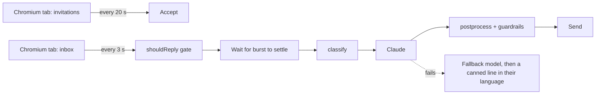

# LinkedIn Auto-Responder

A reply-only bot that runs on a LinkedIn account. It accepts incoming connection requests and answers direct messages with short, human-sounding replies.

## What it does

- **Accepts connection requests**: it checks every 20 s and clicks Accept as soon as the page loads (measured: about 1 s after load). It never sends a message after accepting.
- **Answers DMs**: it watches the inbox every 3 s without reloading. Measured: **6–10 s** to reply to a single message, about 13 s for 3 messages in a row (answered in one reply).
- **Handles unusual messages** (table below) in the sender's language, and never invents facts.
- **Reply-only by design**: there is no code path to start a conversation or send a connection request.

## How it works



- **Playwright** drives a logged-in Chromium profile. There's no third-party API and no credentials leave the machine. All selectors are in [`src/browser/selectors.ts`](src/browser/selectors.ts) and were checked live with `npm run inspect`.
- **Reply-only gate** ([`shouldReply.ts`](src/responder/shouldReply.ts)): the bot replies only if the newest message in a 1:1 thread is from the other person and isn't yet handled. This is checked again right before typing, and the bot refuses LinkedIn's compose screen.
- **Replies**: Claude Sonnet 5.5 (Haiku 5.5 as fallback) writes as the account owner, using only the facts in `.env`. The conversation is passed as data, not as instructions, and a hidden marker in the prompt detects leaks. Images are sent to the model, so it can react to what's in them.
- **Never silent**: if both models fail, the bot sends a canned line in the sender's language, so a reply always goes out.
- **24 h runtime**: pm2 auto-restarts, a watchdog reloads a stuck tab or restarts the bot, the Mac is kept awake, the API is checked every 30 min, and the inbox tab is refreshed every 30 min. SQLite de-dup (hashed keys only) means no duplicate replies after a restart.

## How to run

```bash
npm install
npx playwright install chromium
cp .env.example .env        # fill in persona facts; ANTHROPIC_API_KEY, or `ant auth login`
npm run login               # log in by hand in the browser window (incl. 2FA)
npm run bot:start           # runs under pm2; logs: npm run bot:logs, stop: npm run bot:stop
```

Other commands: `npm start` (in the foreground), `DRY_RUN=true npm start` (writes replies but never sends), `npm test` (108 tests, synthetic data only), `npm run inspect` (checks the selectors against the live page).

The LinkedIn UI must be in English. Don't keep the bot account's chat open elsewhere, because LinkedIn syncs drafts between sessions.

## Unusual messages

| Case | Behaviour (all tested live) |
|---|---|
| Nearly empty (`.`, `?`) / emoji only | Short, friendly opener; one emoji back at most |
| Several in a row / repeated | Waits until they stop (4 s, max 15 s), then sends **one** reply |
| Another language / mixed | Replies in the language of the last message, gender-neutral about itself |
| Very long | Answers the main point in 2–3 sentences, without summarising it back |
| Link / file | Acknowledges it, and never pretends to have opened or read it |
| Image | Reacts to what's actually in the picture (vision) |
| Voice note / video | Asks for the gist in text |
| Rude | Calm and brief, never insults back |
| Can't know (weather, "my favourite colour") | Says so honestly, invents nothing |
| "Are you a bot?" | Honest: an assistant is helping reply right now |
| Prompt injection | Stays in character, reveals nothing |
| "Connect me with X" / bulk messages | Declines; the code has no such capability |
| Contact details asked | Shares only what's in the persona config |

## What it can't do yet

- **DOM changes** can break detection. Selectors are in one file, and `npm run inspect` shows which ones broke.
- It **polls** (every 3 s / 20 s) instead of listening to LinkedIn's live events.
- **Voice notes, videos and file contents** aren't understood, and links aren't opened (on purpose).
- **One account, 1:1 threads only**: group and sponsored threads are skipped.
- It needs the **machine on and the session valid**. A LinkedIn checkpoint or an expired Claude login stops it with a loud log and a macOS notification, and a human has to log in again.
- Message edits and reactions aren't treated as new messages.

## Responsible use

Reply-only, one account, no stealth or CAPTCHA tricks. No one else's messages or data are stored in the repo: the DB keeps only sha256 keys, and logs record message lengths, not text (unless `LOG_CONTENT=true` locally). `.env`, the browser profile, the DB, logs and screenshots are all git-ignored. LinkedIn's terms restrict automation, so this is meant for a test account.

Design notes and the time log are in [DECISIONS.md](DECISIONS.md).
